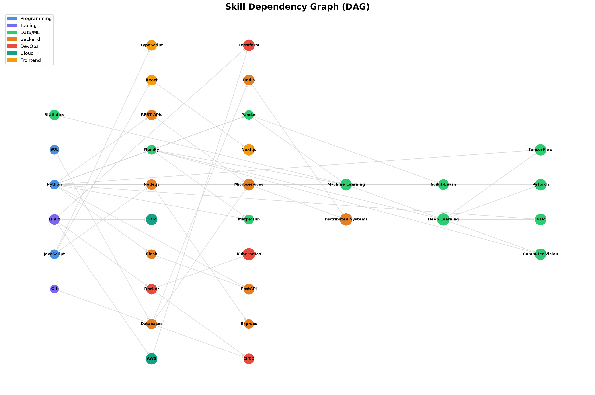

# Skill Graph Analyzer

An explainable skill-gap engine that models technical skills as a Directed Acyclic Graph (DAG) and generates prerequisite-aware learning roadmaps — going beyond keyword matching.

**Live demo:** https://skill-graph-mam4xnrdax3hcyat9n4emf.streamlit.app/



## What it does

Most resume matchers just count keywords and output *"You're missing Kubernetes"*.

This engine outputs:

> **Kubernetes (60h)** — *You already have Docker. Bridge path: `Docker → Kubernetes`.*

It finds transferable skills (Docker → Kubernetes, Python → PyTorch), computes the cheapest prerequisite path, and gives you an ordered study roadmap with hour estimates.

## How I built it

1. **Skill taxonomy** — 34 tech skills with prerequisite relationships stored in `data/skill_taxonomy.json`. Loaded into a `networkx.DiGraph` and validated as a DAG.

2. **Semantic matching** — Used `sentence-transformers` (`all-MiniLM-L6-v2`) to embed resume chunks and skill descriptions. Cosine similarity with a 0.42 threshold detects matches semantically, not by keyword.

3. **Gap analysis** — For each missing target skill, used `nx.shortest_path` to find the cheapest prerequisite bridge from skills the candidate already has. Path cost = sum of `estimated_hours`.

4. **Roadmap generation** — Used `nx.topological_sort` to order missing skills so prerequisites come first.

5. **Typed output** — Every result is a Pydantic v2 `AnalysisResult` schema (fit score, matched skills, transferable strengths, gaps, roadmap).

6. **UI + deployment** — Built a Streamlit interface and deployed on Streamlit Cloud.

## Project structure

```
skill-graph/
├── data/skill_taxonomy.json   # 34 skills, 44 prerequisite edges
├── src/
│   ├── graph_builder.py       # JSON → NetworkX DAG
│   ├── extractor.py           # PDF parsing + embeddings
│   ├── schemas.py             # Pydantic schemas
│   ├── engine.py              # Semantic match + gap analysis
│   ├── visualize_graph.py     # Graph visualization
│   └── benchmark.py           # vs keyword baseline
├── app.py                     # Streamlit UI
└── requirements.txt
```

## Run locally

```bash
pip install -r requirements.txt
python -m src.run_demo        # CLI demo
python -m src.benchmark       # vs keyword baseline
streamlit run app.py          # web UI
```

## Tech stack

Python · NetworkX · sentence-transformers · Pydantic v2 · pdfplumber · Streamlit

## Benchmark

Compared against a naive keyword matcher. The semantic engine finds transferable and semantically-related skills the baseline cannot see (e.g., detecting "Machine Learning" from "Scikit-Learn experience").
